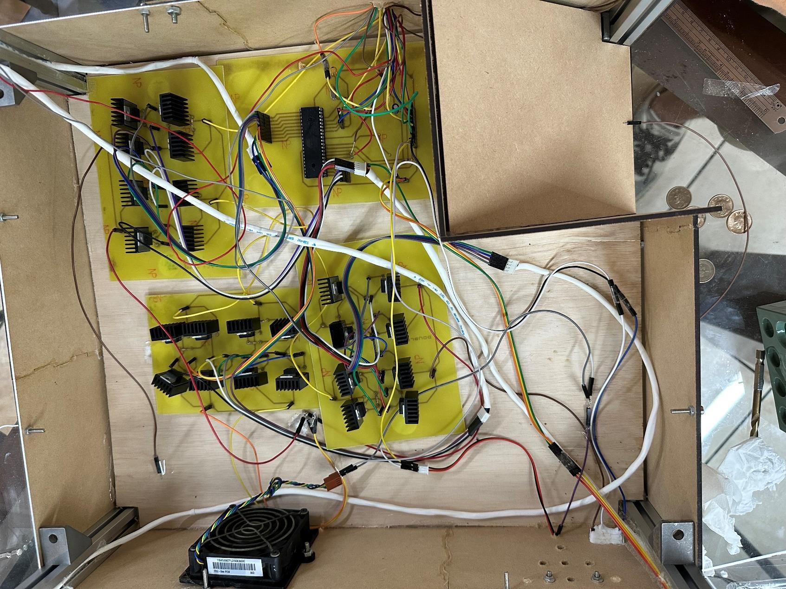
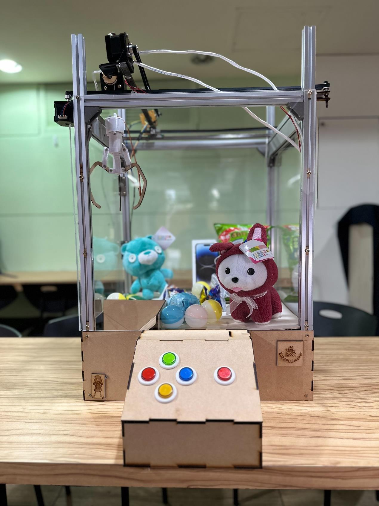
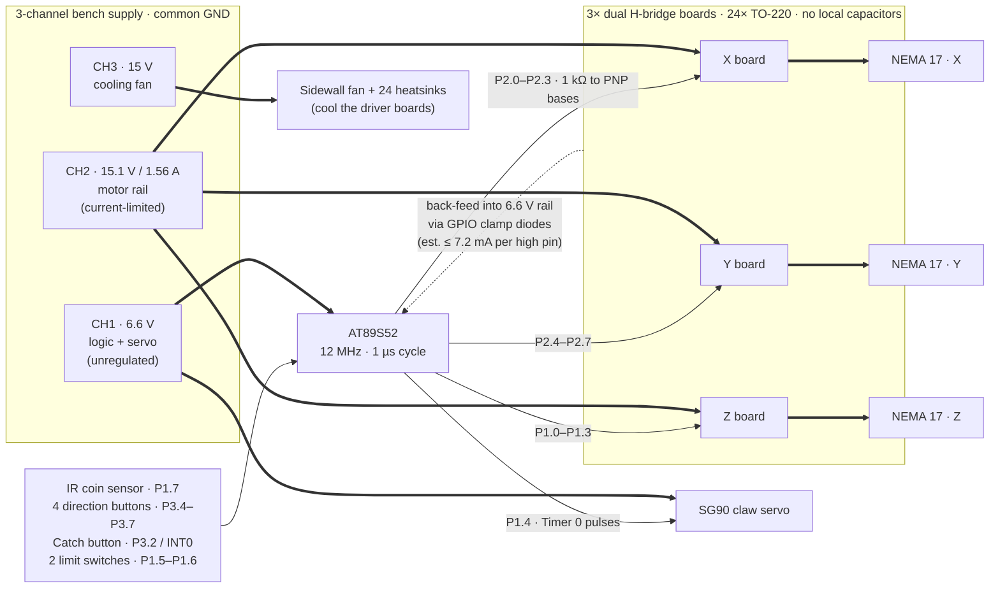
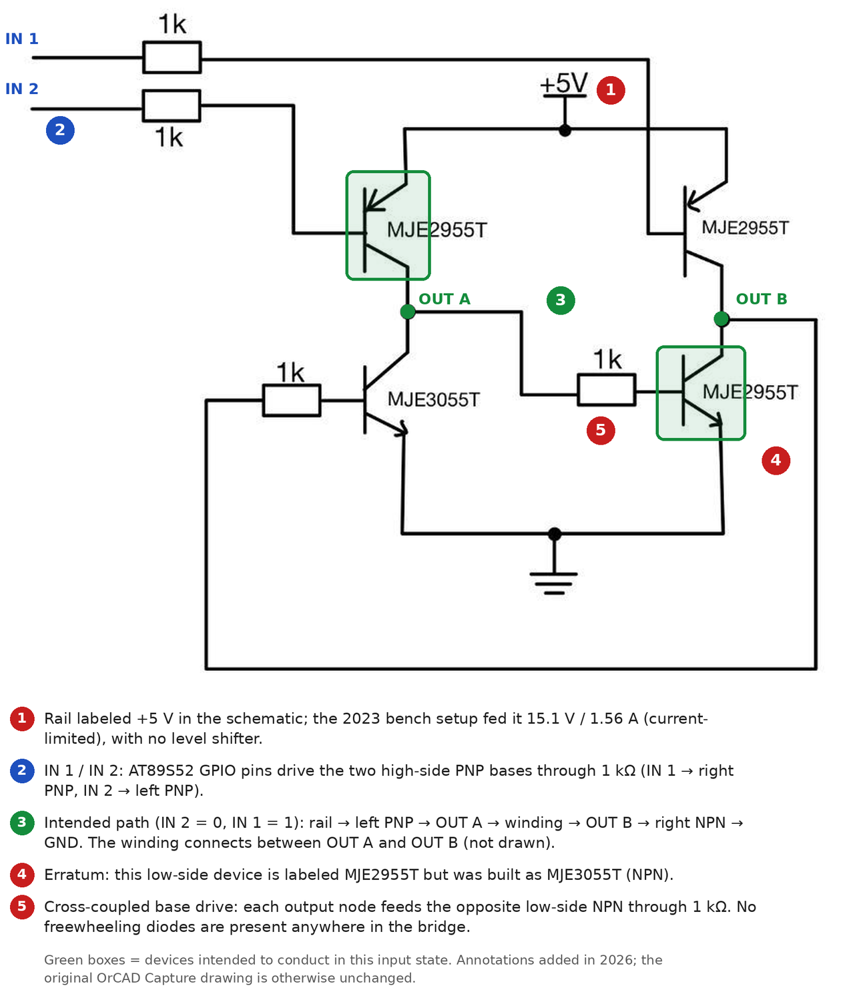
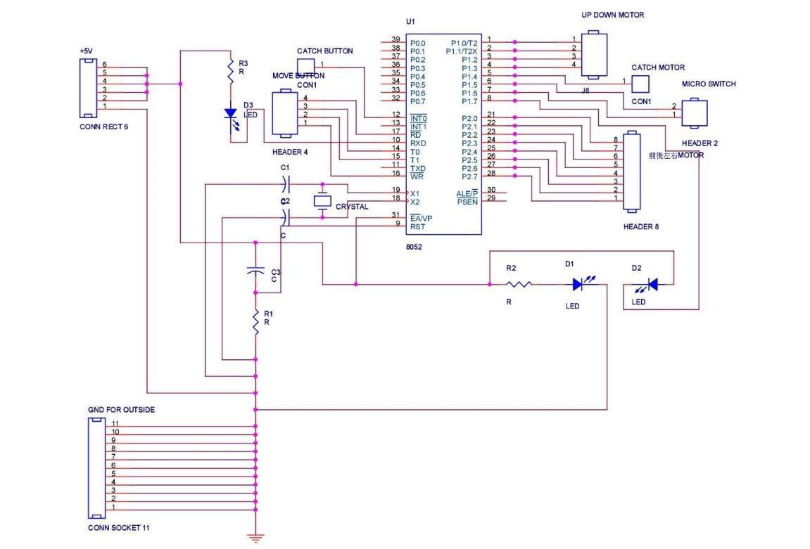
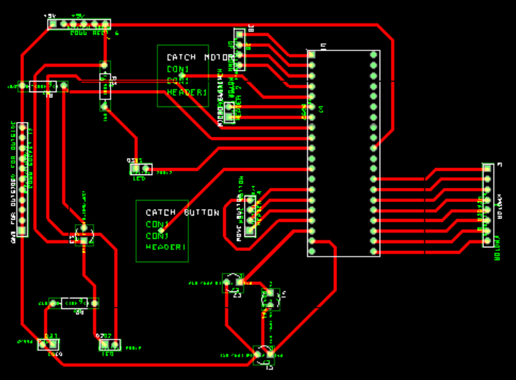
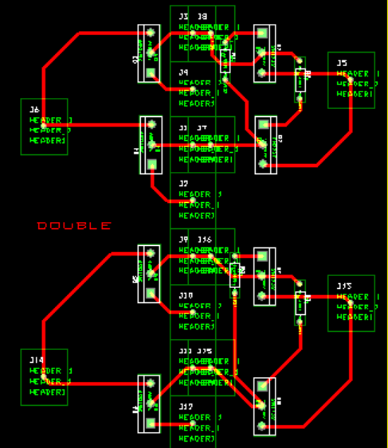

# Discrete BJT H-Bridge Stepper Drives for an 8051 Claw Machine: Build and Power-Stage Failure Analysis

**2nd Place, Microprocessor Final Project Competition** — Department of Electrical Engineering, Feng Chia University<br/>
**Course:** EEEN213 The Experiment of Micro-Processor System (sophomore year, Spring 2023)<br/>
**Built:** June 2023 (5-person team) · **Analyzed & documented:** 2026<br/>
**My role:** Led PCB fabrication and soldering for all four boards, co-designed the schematics and layouts, and wrote the 2026 power/thermal analysis and firmware review ([full attribution](CONTRIBUTIONS.md)).

A three-axis claw machine controlled by an AT89S52 (8051-family) microcontroller programmed in assembly. Competition rules banned motor-driver ICs and modules, so the team drove three stepper motors with **three dual H-bridge boards built from 24 discrete TO-220 power transistors** on in-house etched PCBs. In 2026 I revisited the design from first principles and traced the driver heating to the bridge's drive scheme itself, not only to the closed cabinet: a cross-coupled low side that cannot saturate, and high-side PNPs that the MCU could not turn off at 15.1 V.

<table>
  <tr>
    <td width="62%" valign="top"></td>
    <td width="38%" valign="top"></td>
  </tr>
  <tr>
    <td valign="top"><em>Figure 1a. Electronics bay after the cooling retrofit: AT89S52 main board (top center), three dual H-bridge driver boards fitted with 24 TO-220 heatsinks, and the sidewall fan (bottom).</em></td>
    <td valign="top"><em>Figure 1b. The assembled machine: aluminum-extrusion gantry on salvaged Delta 3D-printer rails, laser-cut cabinet, five-button console, SG90-driven 3D-printed claw.</em></td>
  </tr>
</table>

---

## Engineering Highlights

1. **Discrete power stage under a no-driver-IC rule.** Three identical dual H-bridge boards, each with 4× MJE2955T (PNP, high side) and 4× MJE3055T (NPN, low side) and cross-coupled low-side base drive, run three 1.2 A, 3 Ω bipolar NEMA 17 steppers. The boards were laid out in OrCAD and fabricated in a university PCB lab by UV photolithography, Na₂SiO₃ development, and CuCl₂ spray etching.
2. **Thermal fix, then a first-principles root-cause analysis.** During extended runs in the closed cabinet, the motors gradually lost torque. The team added heatsinks, a fan, and vents, and the symptom did not recur in subsequent tests or during the competition. In 2026, I traced the driver heating to the bridge's drive scheme. The cross-coupled low side would need a current gain of about 330 to switch, so even at the design 5 V more than 40% of the bridge current bypasses the winding; and at 15.1 V, without a level shifter, the MCU cannot turn the high-side PNPs off. Together the six bridges would demand 3–10 A, so the supply's 1.56 A limit almost certainly set the operating point. The estimates come from the schematic, bench settings, datasheets, and a DC circuit model; nothing was measured in 2023.
3. **Interrupt-driven 8051 assembly control** (team firmware, reviewed by me). Two-phase-on full stepping at about 189 steps/s, an INT0-triggered catch sequence, Timer 0–timed servo pulses, and limit-switch homing with step-count ceilings (255 and 400 cycles).
4. **Firmware reviewed against the hardware.** Pinout and polarities cross-checked between the assembly source and the OrCAD schematic; hazards such as unsaved registers in the ISR, non-atomic phase writes, energized idle windings, homing timeouts that pass silently, and missing decoupling are documented without changing the 2023 code.

---

## What It Does

An IR sensor in the coin chute unlocks the controls, and four arcade buttons jog the gantry in X and Y. The Catch button fires external interrupt 0, which runs the rest automatically: lower the claw (Z), close it (servo), raise it, return Y and then X to the prize chute until each limit switch closes (or a step ceiling is reached), and open the claw. Routine-by-routine details and the full flowchart are in [firmware_and_control.md](docs/firmware_and_control.md#3-control-flow).

---

## My Contributions

| Label | Area |
| :--- | :--- |
| **Lead** | PCB fabrication and soldering for all four boards (photolithography, etching, drilling, assembly) |
| **Shared** | OrCAD schematic capture and PCB layout |
| **Team** | Thermal retrofit, system integration, and testing |
| **Sole (2026)** | This repository: documentation, power/thermal analysis, firmware review |

Label definitions and the full breakdown are in [CONTRIBUTIONS.md](CONTRIBUTIONS.md).

---

## System Architecture

Thick arrows are power, thin arrows are signals, and the dotted arrow is an unintended current path found in the 2026 analysis.



---

## Power Stage and 2026 Failure Analysis


*Figure 2. One H-bridge channel annotated in 2026 with the intended current path and the failure mechanisms below. [Original OrCAD drawing](docs/images/bjt_hbridge_schematic.png)*

The MCU drives only the two high-side PNP bases (active-low, through 1 kΩ). Each output node drives the opposite low-side NPN through 1 kΩ, so turning on one PNP should also turn on the diagonal NPN and steer current through the winding.

> [!NOTE]
> **Method.** All figures below are estimates derived from the schematic, the bench-supply settings, component datasheets, the firmware, and a DC circuit model ([`analysis/hbridge_dc_sim.py`](analysis/hbridge_dc_sim.py)). No temperatures, currents, or waveforms were measured in 2023.

| # | Mechanism | Estimate / evidence | Details |
| :---: | :--- | :--- | :---: |
| 1 | Bridge cannot switch cleanly | Each low-side NPN is driven from the opposite output node through 1 kΩ, which needs h<sub>FE</sub> ≈ 330 to saturate into a 3 Ω winding; the model shows 42–45% of the bridge current bypassing the winding even at the design 5 V. At 15.1 V with no level shifter, a logic-high pin clamps near 7.2 V, so the "off" PNP still draws up to ≈ 7.2 mA of base current. The six bridges would demand 3–10 A at 15.1 V, so the 1.56 A supply limit almost certainly held the rail at ≈ 4–10 V. | [§5.1](docs/thermal_troubleshooting.md#51-the-bridge-could-not-switch-cleanly) |
| 2 | MCU pin overstress | Nominal upper bound at 15.1 V: 14.4 mA per low pin and 57.6 mA on Port 2 (3.8× the 15 mA port limit). At the current-limited operating point the model gives 3–9 mA per pin and 12–36 mA on Port 2 (19–36 mA at idle, up to 2.4×). The MCU also runs unregulated at 6.6 V, its absolute maximum. | [§5.2](docs/thermal_troubleshooting.md#52-mcu-pin-loading-and-logic-supply) |
| 3 | Power and junction temperature | Hard bound ≤ 23.6 W into the motor rail; the model gives 6–16 W, 0.24–0.64 W per transistor on average and up to ≈ 1.3 W in the hottest. At 1.3 W, T<sub>J</sub> ≈ 121 °C bare (a lower bound) versus ≈ 45–63 °C with heatsink and fan. How the heat caused the torque loss is not established. | [§5.3](docs/thermal_troubleshooting.md#53-power-budget-and-junction-temperature) |
| 4 | No freewheeling diodes | BJTs have no body diode and none were added, so the winding energy ½LI² at each phase change has no defined path. A voltage-stress and reliability risk; at an estimated 4–23 mW per moving motor it is not a significant heat source. | [§5.4](docs/thermal_troubleshooting.md#54-no-freewheeling-diodes) |
| 5 | Firmware drive timing | The X/Y bridges stay energized between moves (a continuous load). Bit-by-bit phase writes also leave the inputs at `(0, 0)` for 1 µs on about half of the phase changes, under 0.1% of the time. | [§5.5](docs/thermal_troubleshooting.md#55-firmware-contributions) |
| 6 | No local decoupling | The schematics and layouts show no VCC bypass capacitor on the MCU and no local bypass or bulk capacitor at the motor-rail input of any H-bridge board; the MCU shares the unregulated 6.6 V rail with the servo. | [§5.6](docs/thermal_troubleshooting.md#56-power-integrity-no-local-decoupling) |

**Proposed redesign** ([§6](docs/thermal_troubleshooting.md#6-proposed-redesign)), in two versions. Within the 2023 no-driver-IC rule: discrete MOSFET H-bridges with a level-shifted P-channel high side, RC dead time, body-diode or Schottky freewheeling, and shunt-based PWM current regulation at 1.2 A. Without the rule: one integrated stepper driver per motor (for example DRV8825 or TMC2209). Both add single-instruction phase writes with idle de-energization, a regulated 5 V MCU rail separated from the servo supply, and local decoupling.

---

## Firmware and Control

[`src/claw_machine.asm`](src/claw_machine.asm) is about 200 instructions of 8051 assembly at 12 MHz (1 µs machine cycle). It is kept as it ran in 2023; only comments were added in 2026.

- **Coin gate and manual X/Y.** `START` polls the IR sensor; `LOOP` then enables INT0 (`EA`, `IT0`, `EX0`) and `LOOP1` polls the four direction buttons. Each press runs 7 four-step cycles (28 full steps, 50.4° of shaft rotation) of two-phase-on full stepping, with a 5.3 ms software delay per step (≈ 189 steps/s).
- **Catch sequence in the INT0 handler.** Z descends 255 cycles (≈ 5.4 s), the servo closes, Z ascends 255 cycles, then Y and X return to the chute. Servo timing uses Timer 0 in mode 1, polled on `TF0`: 2.0 ms high / 2.0 ms low to close and 1.0 ms high / 1.0 ms low to open. That is a 4 ms or 2 ms period instead of the 20 ms a hobby servo expects.
- **Bounded homing.** `RFRONT` checks P1.5 after every 4-step cycle with a 255-cycle ceiling (≈ 5.4 s); `RLEFT` checks P1.6 with a 400-cycle ceiling (≈ 8.5 s). On timeout, the sequence advances without confirming that the axis reached home: Y homing falls through to X homing, X homing falls through to opening the claw, no fault is reported, and the bridge stays at its last phase.
- **Known limitations.** The handler reuses `R0` without saving it, leaves INT0 disabled until the next direction move, and nothing debounces the inputs. The full list is in [firmware_and_control.md §7](docs/firmware_and_control.md#7-known-limitations-2026-code-review).

<details>
<summary><strong>Hardware–firmware I/O map</strong> (cross-checked against the assembly source and the main board schematic)</summary>

| DIP pin | Port | Firmware symbol | Direction / polarity | Connected to |
| :---: | :--- | :--- | :--- | :--- |
| 1–4 | P1.0–P1.3 | — | Output, active-low* | Z-axis H-bridge board (`UP DOWN MOTOR`); `DOWN` / `UP`; set to `1111` after ascent |
| 5 | P1.4 | — | Output | SG90 servo signal (`CATCH MOTOR`); 2.0 ms / 1.0 ms pulses |
| 6 | P1.5 | `RLEFTBTN`† | Input, active-low | Limit switch polled during the Y-axis return `RFRONT` |
| 7 | P1.6 | `RFRONTBTN`† | Input, active-low | Limit switch polled during the X-axis return `RLEFT` |
| 8 | P1.7 | `INFRARED` | Input, high = coin‡ | 940 nm IR receiver (`D2`); polled in `START` and `START1` |
| 12 | P3.2 / INT0 | — | Interrupt, falling edge | Catch button; runs `EXInterrupt0` (vector `0003H`) |
| 14–17 | P3.4–P3.7 | `FRONTBTN` … `RIGHTBTN` | Inputs, active-low | Direction buttons (`MOVE BUTTON`); polled in `LOOP1` |
| 21–24 | P2.0–P2.3 | — | Output, active-low* | X-axis H-bridge board (`HEADER 8`); `LEFT` / `RIGHT` / `RLEFT`; stays energized at idle |
| 25–28 | P2.4–P2.7 | — | Output, active-low* | Y-axis H-bridge board (`HEADER 8`); `FRONT` / `BACK` / `RFRONT`; stays energized at idle |

\*A logic 0 turns the high-side MJE2955T on. On the 15.1 V rail without a level shifter, a logic 1 does not fully turn it off ([analysis](docs/thermal_troubleshooting.md#51-the-bridge-could-not-switch-cleanly)).<br/>
†The symbol names are swapped relative to the routines that use them: `RLEFTBTN` (P1.5) ends `RFRONT`, and `RFRONTBTN` (P1.6) ends `RLEFT`. The routines poll the raw bit addresses, so behavior is unaffected.<br/>
‡The firmware writes `CLR INFRARED`, which drives this quasi-bidirectional pin low instead of releasing it as an input. Coin detection still worked, most likely because the receiver circuit could overpower the pin's pull-down; this was not measured.

</details>

---

## Validation & Results

Every function below was demonstrated on the integrated machine during the course competition. Results were verified by demonstration; no quantitative test logs (timings, temperatures, currents) were kept.

| Function | What was checked | Result | Known limitation (2026 review) |
| :--- | :--- | :--- | :--- |
| IR coin detection | Inserting a coin unlocks the controls | Working | Pin set up with `CLR` instead of `SETB` |
| X/Y motor control | Each of the four buttons moves the matching axis | Working | Pressing Catch mid-move clears the move counter (`R0`); after the next coin, the interrupted move can run up to 255 more cycles |
| INT0 catch trigger | Catch button starts the automatic sequence | Working | After the next coin, Catch stays disabled until a direction move re-enables INT0 |
| Z-axis movement | Claw lowers and rises fully | Working | Fixed step count; no lower limit switch |
| Limit-switch homing | Gantry returns and stops at each switch | Working | If a switch is missed, the axis drives for the full ceiling (≈ 5.4 s Y, ≈ 8.5 s X), then the sequence continues without confirming home or reporting a fault |
| SG90 claw | Claw closes on the prize and opens over the chute | Working | Pulse period is 4 ms / 2 ms instead of the standard 20 ms |
| Continuous operation | Motor behavior over repeated games in the closed cabinet | Motors weakened before the cooling retrofit; the symptom did not recur afterward | Likely contributors in [thermal_troubleshooting.md](docs/thermal_troubleshooting.md) |

---

## Schematics and PCB Layouts


*Figure 3. AT89S52 main board schematic (OrCAD Capture): 12 MHz crystal with two 30 pF capacitors, RC power-on reset (10 µF / 10 kΩ), 940 nm IR coin-sensor pair (`D1` / `D2`), and headers for the buttons, limit switches, servo, and three driver boards. [Open full resolution](docs/images/at89s52_schematic.png)*


*Figure 4. Main board PCB layout (OrCAD Layout), fabricated in-house by UV photolithography and CuCl₂ spray etching.*


*Figure 5. Dual H-bridge driver board layout (`DOUBLE`, one of three identical boards), with wide traces for the winding current.*

---

## Technical Documentation

| Document | What it covers | Read it for |
| :--- | :--- | :--- |
| [thermal_troubleshooting.md](docs/thermal_troubleshooting.md) | Overheating symptom, fix, 2026 power-electronics analysis, proposed redesign | The power-electronics story |
| [hardware_and_pcb.md](docs/hardware_and_pcb.md) | Board configuration, power distribution, pinout, H-bridge design, mechanical build, PCB fabrication | The circuit and how it was made |
| [firmware_and_control.md](docs/firmware_and_control.md) | Routine map, full control-flow diagram, stepper and servo timing, homing, build notes, code review | Reading the assembly source |
| [CONTRIBUTIONS.md](CONTRIBUTIONS.md) | Team scope vs. personal scope | Who did what |

---

## Repository Structure

```text
.
├── README.md
├── CONTRIBUTIONS.md
├── src/
│   └── claw_machine.asm        # 2023 competition firmware (8051 assembly)
├── analysis/
│   ├── hbridge_dc_sim.py       # 2026 ngspice DC model of the H-bridges
│   └── sim_output.txt          # its output, quoted in thermal_troubleshooting.md §5
└── docs/
    ├── hardware_and_pcb.md
    ├── firmware_and_control.md
    ├── thermal_troubleshooting.md
    └── images/
```

`src/claw_machine.asm` was built with Keil C51 (µVision) and programmed with the 洋天 ATMEL programmer software; see [Build & Programming Notes](docs/firmware_and_control.md#6-build--programming-notes) for the steps.

---

All rights reserved. No open-source license is provided.
