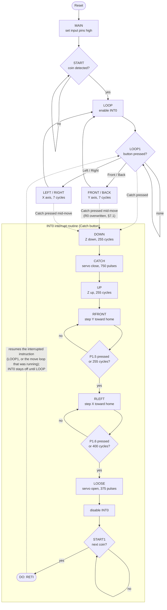

# Firmware & Control Flow

[← Back to README](../README.md)

**Contents:** [1. Overview](#1-overview) · [2. Routine map](#2-routine-map) · [3. Control flow](#3-control-flow) · [4. Stepper motion & homing](#4-stepper-motion--homing) · [5. Servo pulses](#5-servo-pulses) · [6. Build notes](#6-build--programming-notes) · [7. Known limitations](#7-known-limitations-2026-code-review)

---

## 1. Overview

[`src/claw_machine.asm`](../src/claw_machine.asm) is about 200 instructions of 8051 assembly for the AT89S52 at 12 MHz (1 µs per machine cycle). It combines two mechanisms:

- **Polling loop.** The main loop waits for the IR coin sensor, then repeatedly checks the four direction buttons and steps the X or Y motor.
- **Hardware interrupt.** The Catch button is wired to INT0. Pressing it interrupts the polling loop and runs the whole grab-and-return sequence inside the interrupt routine.

---

## 2. Routine Map

| Routine / label | What it does | Hardware involved |
| :--- | :--- | :--- |
| `MAIN` | Sets the button and limit-switch pins high so they can be read as inputs | P3.4–P3.7, P1.5–P1.6 |
| `START` | Waits until the IR sensor reports a coin | P1.7 |
| `LOOP`, `LOOP1` | Enables INT0, then polls the four direction buttons | P3.2, P3.4–P3.7 |
| `FRONT`, `BACK` | Steps the Y motor 7 full cycles forward or back | P2.4–P2.7 |
| `LEFT`, `RIGHT` | Steps the X motor 7 full cycles left or right | P2.0–P2.3 |
| `EXInterrupt0` | INT0 entry point (vector `0003H`); starts the grab sequence | P3.2 |
| `DOWN`, `UP` | Lowers and raises the claw (Z motor, 255 cycles each) | P1.0–P1.3 |
| `CATCH`, `LOOSE` | Closes and opens the claw with servo pulses | P1.4, Timer 0 |
| `RFRONT`, `RLEFT` | Returns Y, then X, toward the chute until a limit switch is pressed | P2.4–P2.7 + P1.5, P2.0–P2.3 + P1.6 |
| `START1`, `DO` | Waits inside the interrupt for the next coin, then returns (`RETI`) | P1.7 |
| `DELAY` | Software delay between stepper phases (~5.3 ms) | — |
| `DELAY2`, `DELAY3`, `WAIT`, `OK` | Timer 0 delays for servo pulses (2.0 ms, 1.0 ms) | Timer 0 |

---

## 3. Control Flow



---

## 4. Stepper Motion & Homing

### Phase sequence

Each motor uses two-phase-on full stepping: both windings are energized in every step, and the polarity pattern rotates through four states.

| Step | Forward (`FRONT`, `LEFT`, `DOWN`, `RLEFT`) | Reverse (`BACK`, `RIGHT`, `UP`, `RFRONT`) |
| :---: | :---: | :---: |
| 1 | `0101` | `1001` |
| 2 | `0110` | `1010` |
| 3 | `1010` | `0110` |
| 4 | `1001` | `0101` |

Bits are written as `bit3 bit2 bit1 bit0` of the 4-pin group (for example, P2.3…P2.0). Bits 0/1 drive one winding's H-bridge and bits 2/3 the other.

### Step timing

`DELAY` runs between every phase change:

```assembly
DELAY:  MOV R3, #100        ; 1 cycle
DL:     MOV R4, #25         ; 1 cycle   (×100)
        DJNZ R4, $          ; 2 cycles  (×25 ×100)
        DJNZ R3, DL         ; 2 cycles  (×100)
        RET                 ; 2 cycles
```

$$T_{\text{step}} = 1 + 100 \times (1 + 25 \times 2 + 2) + 2 = 5303\ \mu\text{s} \approx 5.3\text{ ms}$$

| Motion | Cycles | Full steps | Shaft rotation | Duration |
| :--- | :---: | :---: | :---: | :---: |
| One button press (X or Y) | 7 | 28 | 50.4° | ≈ 0.15 s |
| Z down or up | 255 | 1020 | 5.1 rev | ≈ 5.4 s |
| Y return (`RFRONT`), maximum | 255 | 1020 | 5.1 rev | ≈ 5.4 s |
| X return (`RLEFT`), maximum | 400 | 1600 | 8 rev | ≈ 8.5 s |

Stepping rate ≈ 189 full steps/s. After `UP`, the Z pins are set to `1111`, which is intended to turn the Z bridges off.

### Homing with limit switches

1. **`RFRONT`** steps the Y motor toward the chute and checks `P1.5` after every 4-step cycle. It moves on when the switch closes or after 255 cycles.
2. **`RLEFT`** does the same for the X motor with `P1.6`, with a limit of 400 cycles (`R1 = 2` × `R0 = 200`).

The cycle limits keep the gantry from driving forever if a switch is missed, but a timeout is not treated as a fault: see [§7](#7-known-limitations-2026-code-review), item 7.

---

## 5. Servo Pulses

The SG90 signal on P1.4 is generated in software. Timer 0 (mode 1, 16-bit) times each high and low interval, and the code toggles the pin around it.

| Routine | Action | Timer reload | High / low time | Period | Repeats | Duration |
| :--- | :--- | :---: | :---: | :---: | :---: | :---: |
| `CATCH` (`DELAY2`) | Close claw | `F830h` (2000 counts) | 2.0 ms / 2.0 ms | 4 ms | 5 × 150 = 750 | ≈ 3.0 s |
| `LOOSE` (`DELAY3`) | Open claw | `FC18h` (1000 counts) | 1.0 ms / 1.0 ms | 2 ms | 5 × 75 = 375 | ≈ 0.75 s |

A standard hobby servo expects one pulse every 20 ms; see [§7](#7-known-limitations-2026-code-review).

---

## 6. Build & Programming Notes

The firmware was built and programmed with the toolchain taught in the Keil lab of EEEN213 The Experiment of Micro-Processor System.

| Item | Detail |
| :--- | :--- |
| Language | 8051 assembly, standard Intel-style syntax (`ORG`, `EQU`, `AJMP`, `ACALL`, `$`, `END`) |
| Target | AT89S52, 12 MHz crystal, code in internal flash (`EA` tied high) |
| Assembler / IDE | Keil C51 v9.60a (µVision), free evaluation license |
| Programmer software | 洋天科技 (Yang Tian Technology) ATMEL programmer software V1.2 |
| HEX file | Not included (build outputs are excluded by `.gitignore`) |

### Build and program (course lab procedure)

1. In µVision, create a new project and select **AT89S52** as the device.
2. When asked whether to copy the startup file, choose **No**. The program sets its own reset and interrupt vectors with `ORG`.
3. Add `src/claw_machine.asm` to the source group as an assembly source file.
4. In the target options, enable HEX output, then build. A successful build reports 0 errors and creates the `.hex` file.
5. (Optional) Use µVision's Debug mode to simulate the program, single-step it, and watch the I/O ports and registers.
6. Open the 洋天 programmer software and confirm the programmer is connected. Select vendor **AT89S_MCU** and chip **AT89S52**, load the `.hex` file, and program the chip.

The program uses about 200 instructions, well under the 2 KB code limit of the Keil evaluation license.

---

## 7. Known Limitations (2026 Code Review)

The competition code is kept as it ran in 2023. These issues were found in 2026 and are documented rather than fixed.

1. **Registers not saved in the interrupt.** The direction routines count with `R0`. The interrupt routine reuses `R0` and `R1` without saving them. If Catch is pressed mid-move, `R0` is 0 on return, so the interrupted `DJNZ R0` loops 255 more times and the gantry runs away.
2. **Catch locked after the next coin.** The interrupt routine disables INT0 and waits for the next coin before `RETI`. It returns to wherever it interrupted, usually `LOOP1`, which does not re-enable INT0. Catch stays disabled until the program passes through `LOOP` again, which normally takes a direction-button press.
3. **Coin input pin driven low.** `CLR INFRARED` writes 0 to P1.7. On the 8051, a pin must be written 1 to work as an input. Coin detection still worked with the sensor used, most likely because its output could overpower the pin's low-driving output transistor; this was not measured. `SETB INFRARED` is the correct setup.
4. **Non-standard servo period.** The servo gets a 4 ms (250 Hz) or 2 ms (500 Hz) period instead of 20 ms (50 Hz).
5. **Phase changes one bit at a time.** Each phase change uses two separate bit instructions, so for 1 µs the bridge inputs sit in an intermediate state. About half of the phase changes pass through `(0, 0)` (for example `CLR P2.4`, then `SETB P2.5`), which turns on both high sides; the rest pass through `(1, 1)` (for example `SETB P2.4`, then `CLR P2.5`). The X and Y pins are also left in an energized state after each move, so those bridges conduct while idle. Both add driver heat; see [thermal_troubleshooting.md](thermal_troubleshooting.md#5-2026-analysis-why-the-drivers-ran-hot).
6. **No switch debouncing.** Neither the schematic (no RC filters) nor the code debounces any input. For the direction buttons this is mostly harmless: each press runs a blocking 28-step move (≈ 148.5 ms), long enough to ride out contact bounce. The Catch button on INT0 has no such protection, and `LOOP` re-enables INT0 (`SETB IT0`, `SETB EX0`) without first clearing the pending flag (`CLR IE0`). An edge latched while INT0 was disabled could therefore start a catch sequence as soon as the next direction move returns to `LOOP`. Whether a stale edge actually survives depends on how the AT89S52 handles `IE0` after the handler sets `IT0 = 0`: on standard 8051 cores the flag follows the pin in level mode, which would clear it during the coin wait. This was not tested. Adding `CLR IE0` before `SETB EX0` removes the question.
7. **Homing timeouts pass silently.** When `RFRONT` runs out its 255 cycles, execution falls through to `RLEFT`; when `RLEFT` runs out its 400 cycles, it falls through to `LOOSE`. The code never confirms that the axis reached home and does not report the timeout, and Port 2 stays at its last phase pattern. If a limit switch is missed, the axis keeps driving, possibly against the end of travel, for up to ≈ 5.4 s (Y) or ≈ 8.5 s (X), and the claw then opens wherever the gantry stopped.

[← Back to README](../README.md)
