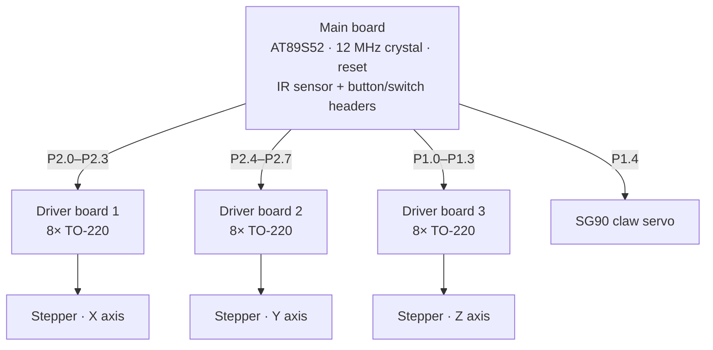
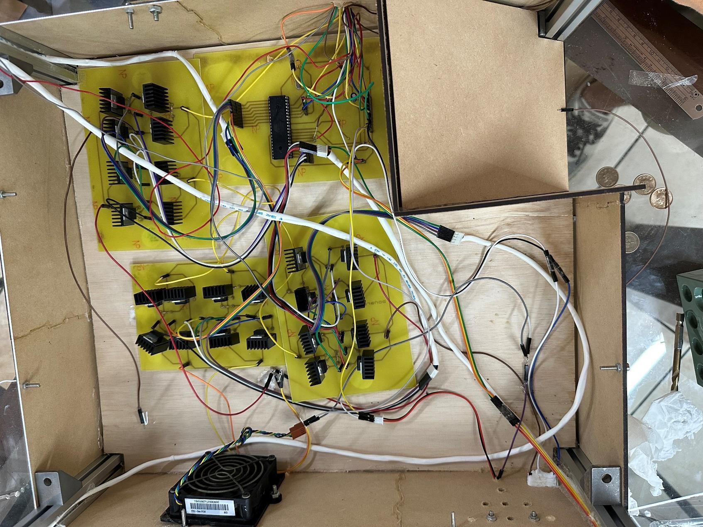
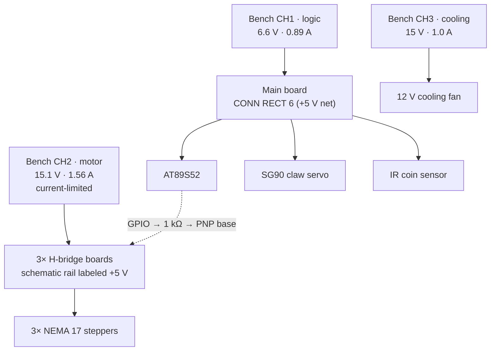
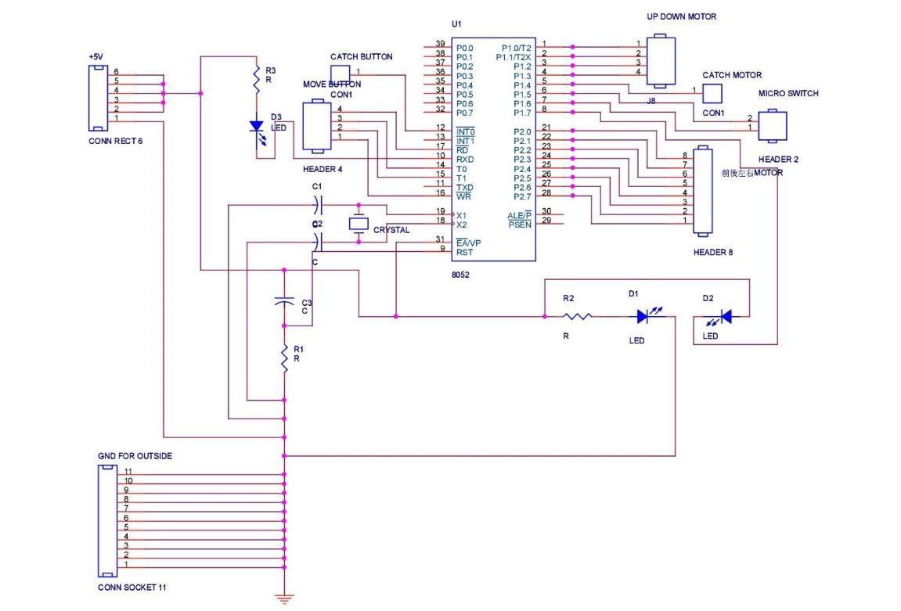
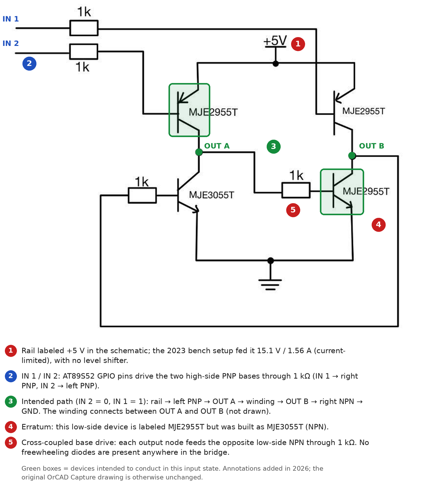
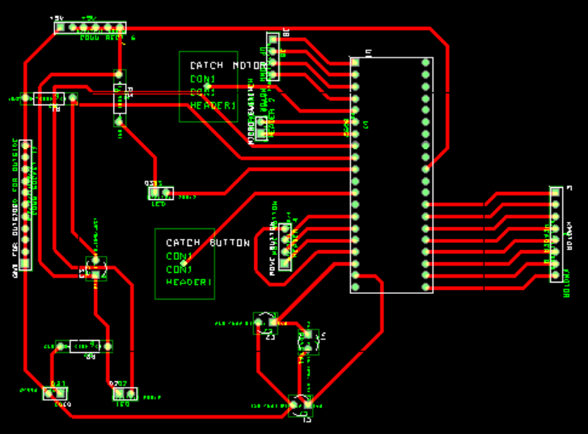
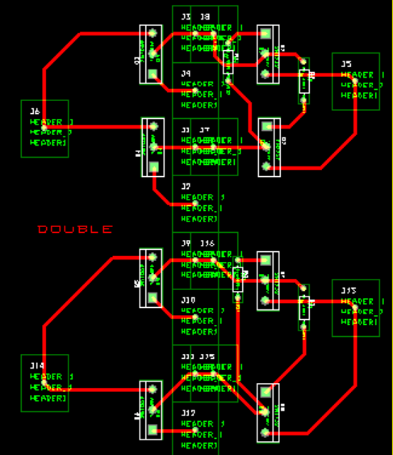

# Hardware Architecture & PCB Fabrication

[← Back to README](../README.md)

**Contents:** [1. Board configuration](#1-board-configuration) · [2. Power distribution](#2-power-distribution) · [3. Main controller](#3-main-controller-at89s52) · [4. H-bridge driver](#4-discrete-bjt-h-bridge-driver) · [5. Actuators & sensors](#5-actuators--sensors) · [6. Mechanical construction](#6-mechanical-construction) · [7. PCB fabrication](#7-pcb-layout--fabrication) · [8. References](#8-references)

---

## 1. Board Configuration

The electronics are split across **four custom PCBs** in the lower electronics bay: one main controller board and three identical dual H-bridge driver boards, one per stepper motor.

| Board | Qty | Main parts | Function |
| :--- | :---: | :--- | :--- |
| Main controller | 1 | AT89S52 (40-pin DIP), 12 MHz crystal, reset network, headers | Reads inputs, generates stepper phase signals and servo pulses |
| Dual H-bridge driver | 3 | 4× MJE2955T (PNP) + 4× MJE3055T (NPN), 8× 1 kΩ base resistors | Two full H-bridges per board, one per stepper winding |

*Electronics bay after the cooling retrofit: main board (top center), three driver boards with heatsinks, sidewall fan (bottom).*

---

## 2. Power Distribution

The machine ran from a three-channel bench power supply with a common ground.

| Rail | Bench setting | Loads | Notes |
| :--- | :--- | :--- | :--- |
| Logic | 6.6 V / 0.89 A | AT89S52, SG90 claw servo, IR emitter/receiver, button and switch inputs | Neither the main board nor the supply harness has a voltage regulator: CH1 feeds the 6-pin `+5V` header (`CONN RECT 6`) directly. The AT89S52 was powered directly at 6.6 V—above its 4.0–5.5 V recommended range and equal to its 6.6 V absolute maximum rating—and the SG90 servo also ran above its 4.8–6.0 V rating. |
| Motor | 15.1 V / 1.56 A, current-limited | Three H-bridge boards | The schematic labels this rail +5 V. Running it at 15.1 V without a level shifter means the MCU's GPIO signals cannot switch the high-side PNPs off; see [thermal_troubleshooting.md](thermal_troubleshooting.md#5-2026-analysis-why-the-drivers-ran-hot). |
| Cooling | 15 V / 1.0 A | SUPERRED CHB7012EBS-OA-P sidewall fan (12 V, 0.28 A) | Wired directly to the 15 V channel with no step-down regulator or series resistor (ground return on the main board's 11-pin ground header), running 25% above its 12 V rating. |

The SG90's three-wire cable splits across three headers on the main board: signal to `CATCH MOTOR` (P1.4), supply to the 6-pin logic header `CONN RECT 6`, and ground to the 11-pin ground header `CONN SOCKET 11`. The servo therefore shares the 6.6 V rail with the AT89S52, and its current when the claw closes loads the MCU's supply directly. (The 0.89 A figure is the channel's current-limit setting, not a measured draw.)

---

## 3. Main Controller (AT89S52)

- **MCU:** AT89S52, 40-pin DIP, 8 KB internal flash (`EA` pin 31 tied to VCC, the `+5V` net).
- **Clock:** 12 MHz crystal on XTAL1/XTAL2 with two 30 pF capacitors → 1 µs machine cycle.
- **Reset:** 10 µF capacitor to VCC and 10 kΩ to GND on RST (pin 9).
- **Decoupling:** none. Apart from the crystal and reset capacitors, the board has no capacitors, including no bypass capacitor at VCC ([thermal_troubleshooting.md §5.6](thermal_troubleshooting.md#56-power-integrity-no-local-decoupling)).

*AT89S52 main board schematic (OrCAD Capture).*

### Pinout

| Pin | Port | Firmware symbol | Direction | Connected to |
| :--- | :--- | :--- | :--- | :--- |
| 1–4 | P1.0–P1.3 | — | Output | Z-axis driver board (claw up/down) |
| 5 | P1.4 | — | Output | SG90 servo signal |
| 6 | P1.5 | `RLEFTBTN` | Input, active-low | Limit switch checked during the `RFRONT` return |
| 7 | P1.6 | `RFRONTBTN` | Input, active-low | Limit switch checked during the `RLEFT` return |
| 8 | P1.7 | `INFRARED` | Input | IR coin sensor (high = coin) |
| 12 | P3.2 / INT0 | — | Interrupt input | Catch button (falling edge) |
| 14–17 | P3.4–P3.7 | `FRONTBTN` … `RIGHTBTN` | Inputs, active-low | Front, Back, Left, Right buttons |
| 21–24 | P2.0–P2.3 | — | Output | X-axis driver board (`LEFT` / `RIGHT` / `RLEFT` routines) |
| 25–28 | P2.4–P2.7 | — | Output | Y-axis driver board (`FRONT` / `BACK` / `RFRONT` routines) |
| 9 / 18–19 / 20 / 31 / 40 | RST / XTAL / GND / EA / VCC | — | — | Reset, crystal, ground, internal-flash enable, logic supply |

> [!NOTE]
> **Limit-switch symbols.** In the code, `RFRONT` polls `P1.5` (`RLEFTBTN`) and then jumps to `RLEFT`; `RLEFT` polls `P1.6` (`RFRONTBTN`) and then jumps to `LOOSE`.

---

## 4. Discrete BJT H-Bridge Driver

### Why discrete transistors

The competition banned integrated driver ICs (L298N, L293D) and pre-built driver modules. The team first tried Darlington stages and small-signal A1015/C1815 transistors; neither drove the 1.2 A stepper windings reliably. The final design uses complementary TO-220 power transistors:

| Position | Part | Type | Key ratings |
| :--- | :--- | :--- | :--- |
| High side | MJE2955T | PNP | 10 A, 60 V VCEO, hFE ≥ 20 at 4 A |
| Low side | MJE3055T | NPN | 10 A, 60 V VCEO, hFE ≥ 20 at 4 A |
| Base drive | 1 kΩ | Resistor | One per transistor |

Each stepper has two windings, each driven by one full H-bridge (4 transistors), so each motor needs one 8-transistor board.

### How one bridge works

*One H-bridge channel with 2026 annotations. [Original OrCAD drawing](images/bjt_hbridge_schematic.png)*

- The MCU drives only the two **high-side PNP bases** (active-low, through 1 kΩ).
- Each **output node** drives the **opposite low-side NPN** through 1 kΩ (cross-coupling). When the left PNP pulls OUT A high, OUT A turns on the right NPN, and current flows A → B through the winding.
- Inputs `(1, 0)` or `(0, 1)` reverse the winding current. `(0, 0)` would turn on both high sides and is unsafe.

### Known issues in the drawing and the build

1. **Label erratum.** The bottom-right transistor is labeled MJE2955T in the drawing; the boards used MJE3055T (NPN) in both low-side positions.
2. **Rail voltage.** The drawing's +5 V rail was run at 15.1 V on the bench with no level shifter, so the PNPs could not be switched off cleanly.
3. **No freewheeling diodes.** Bipolar transistors have no body diode, and none were added, so winding energy at each step has no defined path and must be dissipated in the switches, base networks, wiring, or supply.
4. **No capacitors on the driver boards.** The driver schematic and layout show no local bypass or bulk capacitor at the motor-rail input. The resulting rail transients were not measured.

Items 2–4 are analyzed in [thermal_troubleshooting.md](thermal_troubleshooting.md).

---

## 5. Actuators & Sensors

| Device | Part | Key specifications | Notes |
| :--- | :--- | :--- | :--- |
| Stepper motors (3×) | NEMA 17, 42 × 47 mm | 2-phase bipolar, 1.8°/step, 1.2 A, 3 Ω, 3.6 V rated | X, Y gantry axes and Z winch |
| Claw servo | TowerPro SG90 | 4.8–6 V, 1.2–1.4 kg·cm stall torque, 0.12 s/60° | Signal on P1.4; powered from the 6.6 V logic header (CONN RECT 6) |
| Coin sensor | LED-940R-5T/R pair | 940 nm IR, 30° beam | Chosen after a photo-interrupter (false triggers from room light) and an SMD micro-switch (light coins did not press it; heavy coins bounced) failed |
| Control buttons (5×) | 5111 arcade buttons | Snap-action micro-switch, 6 A / 250 VAC | Front, Back, Left, Right, Catch |
| Limit switches (2×) | 5095 bent-lever micro-switch | 3 A / 125–250 VAC | Home position above the prize chute |
| Cooling | 24× TO-220 heatsinks, 1× sidewall fan | See [§2](#2-power-distribution) | Added during integration |

---

## 6. Mechanical Construction

- **Gantry:** linear rails salvaged from a decommissioned Delta 3D printer, mounted on an aluminum-extrusion frame. The salvaged rails were somewhat sticky; solid grease worked better than liquid oil.
- **Enclosure and console:** laser-cut MDF cabinet, acrylic side panels, and a five-button arcade console.
- **Claw:** 3D-printed claw driven by the SG90 servo, based on a public Thingiverse model ([thing:4249843](https://www.thingiverse.com/thing:4249843)).
- **Equipment:** laser cutting and 3D printing used the facilities of the FCU Maker Club; the "2022FCUmaker" emblem on the cabinet is the club's.

---

## 7. PCB Layout & Fabrication

All four boards were laid out in OrCAD Layout and fabricated in the Feng Chia University PCB lab.

*Main board layout.*

*Dual H-bridge driver board layout (`DOUBLE`), with wide traces for the winding current.*

### Fabrication process

| Step | What was done | Equipment / conditions |
| :--- | :--- | :--- |
| 1. Artwork | Printed the layout 1:1, black on clear transparency film | — |
| 2. Laminate prep | Peeled the protective film from positive presensitized copper-clad board and aligned the film, 1–3 cm from the vacuum port | — |
| 3. UV exposure | Vacuum-frame exposure | KINSTEN exposure unit; ~60 s (transparency film), ~90 s (semi-transparent film) |
| 4. Development | Agitated in sodium metasilicate developer until the exposed resist cleared, then rinsed | Na₂SiO₃, 1:20 |
| 5. Etching | Conveyor spray etching and water rinse | KINSTEN KAE-90S, CuCl₂, speed dial ~70 |
| 6. Shear and drill | Scored a 5–10 mm margin, sheared on a guillotine cutter, drilled all through-holes | Bench drill press |
| 7. Assembly | Soldered the 40-pin socket, crystal, passives, headers, and 24 TO-220 transistors; continuity-checked each board | Heatsinks added later during integration |

---

## 8. References

- Motor-driver circuit reference: <https://angel91250.pixnet.net/blog/post/21525085>
- Claw 3D model: <https://www.thingiverse.com/thing:4249843>
- MJE2955T datasheet: <https://www.digikey.tw/zh/products/detail/stmicroelectronics/MJE2955T/603646>
- MJE3055T datasheet: <https://www.digikey.tw/zh/products/detail/stmicroelectronics/MJE3055T/603598>
- SG90 datasheet: <https://www.oursteam.com.tw/view-product.php?id=279>

[← Back to README](../README.md)
