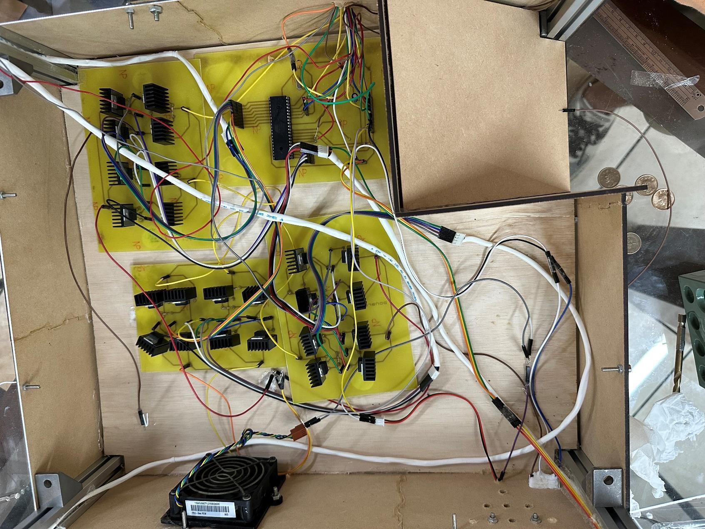

# Thermal Troubleshooting & Power-Electronics Case Study

[← Back to README](../README.md)

| Stage | Summary |
| :--- | :--- |
| [1. Observed problem](#1-observed-problem) | Stepper motors gradually weakened during long runs in the closed cabinet |
| [2. Investigation](#2-investigation) | The uncooled TO-220 driver transistors in the sealed electronics bay were hot to the touch |
| [3. Implemented solution](#3-implemented-solution) | 24 TO-220 heatsinks, a sidewall cooling fan, ventilation openings |
| [4. Observed outcome](#4-observed-outcome) | Symptom did not recur in later integration tests or during the competition |
| [5. 2026 analysis](#5-2026-analysis-why-the-drivers-ran-hot) | High-side PNP turn-off failure, conduction losses, no freewheeling diodes, firmware drive timing, missing decoupling |
| [6. Proposed redesign](#6-proposed-redesign) | Proper high-side drive, flyback protection, current regulation, local decoupling |

> [!NOTE]
> **Method.** Sections 1–4 describe the 2023 build. Section 5 is a 2026 analysis derived from the schematic, the bench-supply settings, component datasheets, and the firmware. No temperatures, currents, or waveforms were measured in 2023.

---

## 1. Observed Problem

Each axis worked in short bench tests with the cabinet open. After several consecutive games with the cabinet closed, the stepper motors moved sluggishly and lost torque.

## 2. Investigation

The three H-bridge boards sit in a closed wooden/acrylic bay under the prize floor. The 24 TO-220 transistors had no heatsinks and were hot to the touch. With no airflow through the bay, heat from the driver stage had nowhere to go.

## 3. Implemented Solution

1. **Heatsinks:** a finned aluminum heatsink on every MJE2955T and MJE3055T (8 per board, 24 in total).
2. **Forced air:** a SUPERRED CHB7012EBS-OA-P fan (12 V, 0.28 A) on the cabinet sidewall, powered from a separate 15 V / 1.0 A supply channel.
3. **Ventilation:** openings in the cabinet panel so the fan could move air across the driver boards.

## 4. Observed Outcome

| Aspect | Before | After |
| :--- | :--- | :--- |
| Driver cooling | Bare TO-220 packages | 24 heatsinks + sidewall fan |
| Bay airflow | Sealed | Fan + vents |
| Behavior | Motors weakened over continuous runs | Symptom did not recur in later tests or during competition judging |

---

## 5. 2026 Analysis: Why the Drivers Ran Hot

The cooling retrofit treated the symptom. Looking back at the circuit, the way the drivers were biased and switched points to the drive stage itself as the main heat source.

### 5.1 The high-side PNPs could not turn off

The schematic labels the H-bridge rail **+5 V** and connects each AT89S52 pin straight to a PNP base through 1 kΩ, with no level shifter. On the bench, that rail was set to **15.1 V with a 1.56 A current limit**. These initial settings were kept fixed for every test and for the competition demo; the operating voltage and current were not recorded.

**At the intended +5 V,** base current would be only

$$I_B \approx \frac{5.0 - 0.7}{1\text{ k}\Omega} = 4.3\text{ mA}$$

The datasheet specifies hFE = 20–70 only at IC = 4 A; at lower currents a power BJT's gain is typically higher. Even assuming a gain of 100, 4.3 mA of base current supports only about 0.43 A of collector current, well below the motors' 1.2 A rating. The team raised the rail to 15.1 V because the motors lacked torque at 5 V.

**At 15.1 V,** the PNP emitter sits well above the MCU's logic-high level:

- **Pin low (0 V):** $I_B \approx (15.1 - 0.7 - 0)/1\text{ k}\Omega = 14.4\text{ mA}$, so the PNP is on, as intended.
- **Pin high:** an 8051 pin written high has only a weak pull-up. Current from the PNP base pulls the pin above VCC until its upper protection diode clamps it near VCC + 0.6 V. With VCC at 6.6 V (§5.2), the pin clamps near 7.2 V (or ≈ 5.6 V at a nominal 5 V VCC), giving

$$I_B \approx \frac{15.1 - 0.7 - 7.2}{1\text{ k}\Omega} \approx 7.2\text{ mA}\quad(\approx 8.8\text{ mA at }V_{\text{CC}} = 5\text{ V})$$

So the "off" PNP still conducts, and about 7.2–8.8 mA per pin is pushed back into the logic supply.

**Predicted result: partial shoot-through.** With both high-side PNPs conducting, both output nodes rise and turn on both cross-coupled low-side NPNs, so current can flow from rail to ground through both legs of every powered bridge. Only the difference between the two base drives (14.4 mA vs. 7.2–8.8 mA) steers current through the winding. How much shoot-through current flows depends on the transistors' gain and temperature and was not measured; the supply's 1.56 A current limit is the only firm upper bound, and if the supply reaches that limit its output drops below 15.1 V. Likewise, the share of the driver heating caused by shoot-through, as opposed to winding current and switching, is unknown.

### 5.2 MCU pin loading and logic supply

Per the AT89S52 datasheet, steady-state sink current is limited to **10 mA per pin**, **15 mA per 8-bit port** (ports 1–3), and **71 mA for all pins combined**.

| Case | Estimated sink current | Limit | Over by |
| :--- | :---: | :---: | :---: |
| One pin low | 14.4 mA | 10 mA per pin | 1.4× |
| Port 2 (X + Y motors, 4 pins low) | 4 × 14.4 = 57.6 mA | 15 mA per port | 3.8× |
| Whole chip (Z also moving, 6 pins low) | 6 × 14.4 = 86.4 mA | 71 mA total | 1.2× |

The logic channel (CH1, 6.6 V) feeds the AT89S52 directly with no regulator, so VCC is 6.6 V rather than 5 V. This sets the 7.2 V clamp level used in §5.1, and the SG90 servo shares the same rail. Rail settings and component ratings are in [hardware_and_pcb.md §2](hardware_and_pcb.md#2-power-distribution).

### 5.3 Power budget and junction temperature

**Input power.** Because every bridge leg conducts (§5.1) and the X/Y bridges stay energized at idle (§5.5), the motor rail can draw current continuously, up to the supply's limit. The supply settings cap the motor-rail input power:

$$P_{\text{in}} \le 15.1\text{ V} \times 1.56\text{ A} \approx 23.6\text{ W}$$

This power splits as

$$P_{\text{in}} = P_{\text{BJT}} + P_{\text{base}} + P_{\text{winding}} + P_{\text{other}}$$

where Pwinding is copper loss in the six stepper windings and Pother covers wiring, connectors, and the base current returned to the logic supply.

**Base resistors.** Each bridge has four 1 kΩ base resistors:

| Resistor | Estimated power |
| :--- | :---: |
| PNP, pin low | (14.4 mA)² × 1 kΩ ≈ 0.21 W |
| PNP, pin high | (7.2–8.8 mA)² × 1 kΩ ≈ 0.05–0.08 W |
| Two cross-coupled NPN resistors (depends on output-node voltage) | 0.09–0.40 W |
| **Per bridge** | **≈ 0.35–0.68 W** |
| **Six bridges** | **≈ 2.1–4.1 W** |

0.21 W is already close to the 0.25 W rating of a standard ¼ W resistor.

**Transistors.** Winding and other losses cannot be negative, so the total transistor dissipation is bounded by

$$P_{\text{BJT}} \le P_{\text{in}} - P_{\text{base}} \approx 19.5\text{–}21.5\text{ W}$$

This figure inherits the assumptions of the base-resistor estimate above (pin voltages and output-node voltages at one operating point). If the base networks dissipate less than estimated, the bound rises toward the full 23.6 W, so the only assumption-free bound is PBJT ≤ Pin ≤ 23.6 W. The actual figure is lower by whatever the windings and wiring dissipate: 0.3 A in each of the six 3 Ω windings would be about 1.6 W, and 0.5 A about 4.5 W.

**Per-transistor dissipation.** The 24 transistors do not share this power equally: the PNPs see different base drives (14.4 mA vs. 7.2–8.8 mA), and the X/Y boards idle while the Z board steps. Dividing the bound evenly gives an average of about **0.85 W** per transistor; the table below covers a range around that average.

**Junction temperature.** TJ = Tamb + P × RθJA. Before the retrofit: bare TO-220, RθJA ≈ 62.5 °C/W (typical free-air value for a TO-220 package), assumed bay temperature 40 °C. After: heatsink + forced air, assumed RθJA ≈ 15–20 °C/W, bay at 25–30 °C.

| Assumed dissipation per transistor | Before retrofit | After retrofit |
| :--- | :---: | :---: |
| 0.5 W (lightly loaded device) | ≈ 71 °C | ≈ 33–40 °C |
| 0.85 W (even split of the bound) | ≈ 93 °C | ≈ 38–47 °C |
| 1.5 W (more heavily loaded device) | ≈ 134 °C | ≈ 48–60 °C |

**What the scenarios show.** Without cooling, the average case is below the 150 °C junction limit, which is consistent with no transistor failing. The more heavily loaded devices could approach that limit, leaving little thermal margin, which is another reason for the redesign in §6. The average and heavier cases run hot enough to explain the torque loss: BJT current gain rises with temperature, so a hotter driver passes more shoot-through current, and with total supply current capped at 1.56 A, less differential current is left for the windings. In every scenario the retrofit lowers junction temperature substantially, which is consistent with cooling alone curing the symptom without any circuit change.

### 5.4 No freewheeling diodes

MOSFETs have a built-in body diode; the MJE2955T and MJE3055T do not, and no external diodes were fitted. Each phase change interrupts winding current, and the energy stored in the winding inductance ($E = \frac{1}{2}LI^2$) has no defined path for recirculation. It must be dissipated somewhere in the switching transistors, the base networks, the wiring, or the supply; how it divides among them was not measured.

### 5.5 Firmware contributions

From [`src/claw_machine.asm`](../src/claw_machine.asm):

- **X/Y bridges never turn off.** After each move or homing pass, Port 2 stays at its last step pattern (`1001` or `0101`), so the X and Y bridges conduct continuously while the machine waits. The Z pins are set to `1111` after `UP`, but at 15.1 V even `1111` cannot turn the PNPs off (§5.1).
- **Brief `(0, 0)` during some phase changes.** A phase change is written as two bit instructions, so for 1 µs the bridge inputs sit in an intermediate state. About half of the phase changes pass through `(0, 0)` (for example `CLR P2.4` and then `SETB P2.5`); the rest pass through `(1, 1)` (for example `SETB P2.4` and then `CLR P2.5`). In the `(0, 0)` state both high-side PNPs turn on while the outgoing NPN may still be conducting during its storage time (typically several µs), which can add a brief shoot-through pulse.

### 5.6 Power integrity: no local decoupling

The schematics and board layouts show no local decoupling anywhere in the system:

- **Main board.** The only capacitors are the two crystal capacitors (C1, C2) and the reset capacitor (C3). There is no bypass capacitor between the AT89S52's VCC and GND pins.
- **H-bridge boards.** The driver schematic and layout show no local bypass or bulk capacitor at the motor-rail input. The resulting rail transients were not measured.

In this build that matters for three reasons:

1. Every phase change interrupts winding current with no freewheeling path (§5.4). With no local capacitance at the boards, the resulting di/dt acts on the inductance of the supply wiring and can appear as ringing on the motor rail at the transistors.
2. The 6.6 V logic rail is unregulated and shared by the AT89S52 and the SG90 servo (§5.2), and it also absorbs the base current pushed back through the MCU pins' clamp diodes (§5.1). Servo current steps and that back-fed current both disturb an MCU supply that already sits at the AT89S52's 6.6 V absolute maximum.
3. The reset capacitor connects RST to VCC, so fast supply transients couple directly onto the reset pin.

No supply waveforms were captured in 2023, so the size of these effects is unknown; they are risks identified from the drawings, not observed failures. The redesign (§6) adds local capacitance at each board.

---

## 6. Proposed Redesign

1. **Proper high-side drive.** Add an NPN level-shifter between the 5 V MCU and the 15 V PNP bases. Better: replace the bipolar stage with power MOSFETs and a half-bridge gate driver (for example IR2104), so the switches turn fully on and off.
2. **Flyback protection.** Fit fast-recovery or Schottky diodes (for example 1N5822 or UF4007) across every switch to give winding current a safe path at each phase change.
3. **Current regulation.** Sense winding current with a low-side shunt and regulate it at the 1.2 A rating with a PWM chopper, instead of relying on transistor voltage drop and the bench supply's current limit.
4. **Cleaner firmware drive.** Write each 4-bit phase pattern in one instruction (`MOV`, or masked `ANL`/`ORL`), insert a short all-off dead time between phases, and switch the X/Y windings off when the gantry is idle.
5. **Regulated supply rails.** Feed the AT89S52 from a regulated 5.0 V rail, put the SG90 servo on its own 5–6 V regulator so claw-stall current does not load or force up the MCU supply, and run the 12 V fan from a 12 V supply.
6. **Local decoupling.** Place a 0.1 µF ceramic capacitor at the AT89S52 VCC pin, and bulk electrolytic plus ceramic capacitance at the rail entry of each H-bridge board, so switching current is supplied locally instead of through the harness.

[← Back to README](../README.md)
